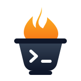

<h1 align="center">
  <picture>
    <source media="(prefers-color-scheme: dark)" srcset="docs/assets/crucible-mark-dark.svg">
    <source media="(prefers-color-scheme: light)" srcset="docs/assets/crucible-mark-light.svg">
    
  </picture>
  <br>
  Crucible
</h1>

<p align="center">
  <a href="#status"></a>
  <a href="pyproject.toml"></a>
  <a href="https://learn.microsoft.com/en-us/azure/container-apps/sandboxes-overview"></a>
  <a href="LICENSE"></a>
</p>

<a id="status"></a>

> [!WARNING]
> Experimental; not production-ready. Settings and CLI behavior may change.
> Use an approved subscription and review plans before applying.

Deploy Crucible into each customer's approved Azure subscription to create
development workspaces on Azure Container Apps Sandboxes.

Bicep powers the underlying Azure resources and RBAC. The Python CLI manages
workspaces and persistent disks through the Azure Container Apps Sandbox SDK. Workspaces
use Microsoft's `azure-dev` image, with bootstrap to install missing tools.

## Get started

With Python 3.12+ and uv installed, run:

```bash
uv sync
uv run crucible --help
```

Review the plan before adding `--apply`. Workspace plans read Azure deployment
outputs; the guides below cover deployment and authentication.

## Connect to your workspace

After [deploying a workspace](#deploy), resume it if stopped and open its
interactive shell in the [Sandboxes portal](https://sandboxes.azure.com/).
Get customer approval for outbound Microsoft Dev Tunnels access before connecting.

Start the tunnel **inside the sandbox**, not on your laptop:

```bash
code tunnel --name alice-dev
```

Review and accept the VS Code Server license, then follow the sign-in prompts.
Pass `--accept-server-license-terms` only if you agree to the license.
Keep this command running in the foreground while connected.
After [bootstrap](docs/tools.md), open a new shell to use
`crucible-tunnel --name alice-dev`, the
[packaged helper](src/crucible/assets/connect-tunnel.sh).

### Local VS Code (recommended)

1. Install the [Remote - Tunnels extension](https://marketplace.visualstudio.com/items?itemName=ms-vscode.remote-server)
   in VS Code on your laptop.
2. Open the Command Palette and run **Remote Tunnels: Connect to Tunnel**.
3. Sign in with the same account used to start the tunnel and select `alice-dev`.
4. Open `/workspaces` or your project folder beneath it.

### Browser with vscode.dev

Open the `vscode.dev` URL printed by the tunnel command. Sign in with the same
account and open `/workspaces` or your project folder.

Both options connect to the same sandbox without a public SSH endpoint.
Keep project files under `/workspaces` so they persist on the Data Disk.
After a stop/resume, restart the tunnel and reconnect. See
[workspace lifecycle and access](docs/workspaces.md) for idle suspension and permissions.

## CLI

Cloud commands require Azure CLI and `az login`. Pass `--subscription` and
`--resource-group` explicitly. `--deployment` defaults to `crucible`.

### Deploy

Configure a [parameter file](infra/parameters/), then plan the deployment:

```bash
uv run crucible deploy --subscription SUBSCRIPTION --resource-group RESOURCE_GROUP \
  --parameters infra/parameters/customer.local.bicepparam
```

| Execution flag | Behavior |
|---|---|
| None | Compile parameters and check resource-group existence; no changes |
| `--what-if` | Preview ARM changes only |
| `--apply` | Deploy infrastructure and provision missing workspaces/disks |

Use either `--what-if` or `--apply`, never both. Provisioning leaves existing
workspaces alone, without rebuilding or deleting them.

### Workspaces

Workspace commands need settings from a successful subscription deployment.
Replace `ACTION` and add the required arguments:

```bash
uv run crucible workspace ACTION --subscription SUBSCRIPTION \
  --resource-group RESOURCE_GROUP --deployment crucible
```

| Action | Additional required arguments | Purpose |
|---|---|---|
| `provision` | None | Create missing declared workspaces and dedicated disks |
| `create` | `--name NAME --volume VOLUME` | Create a workspace using an existing unattached Data Disk |
| `bootstrap` | `--name NAME` | Install missing tools on a running workspace |
| `auto-suspend` | `--name NAME` and `--enable` or `--disable` | Toggle idle suspension without restarting |
| `stop` | `--name NAME` | Suspend a workspace |
| `resume` | `--name NAME` | Resume a stopped workspace |

Add `--apply` to execute a workspace command. Without it, the command only plans.
You pay for compute while a workspace runs, including when auto-suspend is
disabled. See [workspaces](docs/workspaces.md) for persistence, bootstrap, and
remote access.

For command-specific help:

```bash
uv run crucible deploy --help
uv run crucible workspace --help
uv run crucible workspace auto-suspend --help
```

## Contributing

Use the optional [Dev Container](docs/development.md#dev-container) to work on Crucible.

## Guides

- [Infrastructure](docs/infrastructure.md): deployment, networking, RBAC, workspace inventory.
- [Workspaces](docs/workspaces.md): persistent disks, lifecycle, remote access, verification status.
- [Tools](docs/tools.md): Bootstrapped tools and default image.
- [Development](docs/development.md): prerequisites, local checks, code conventions.

## License

Released under the [MIT license](LICENSE).
